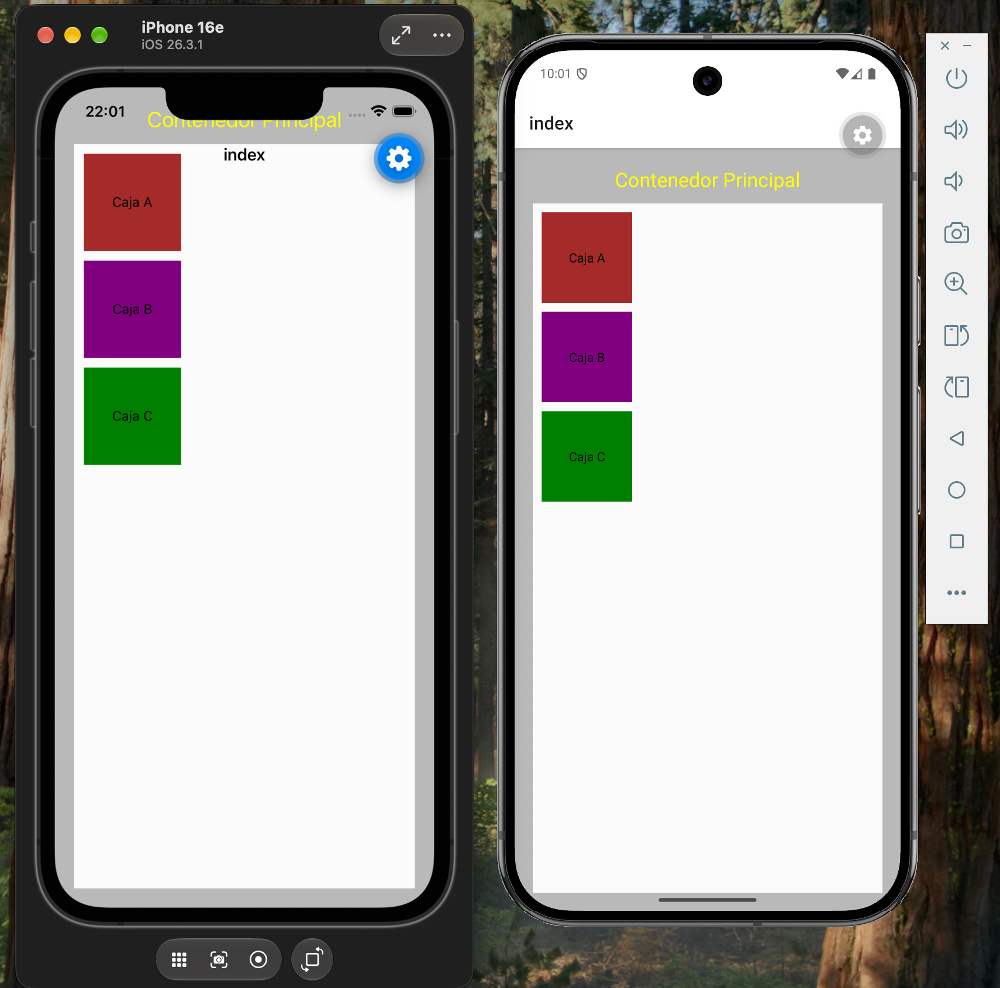
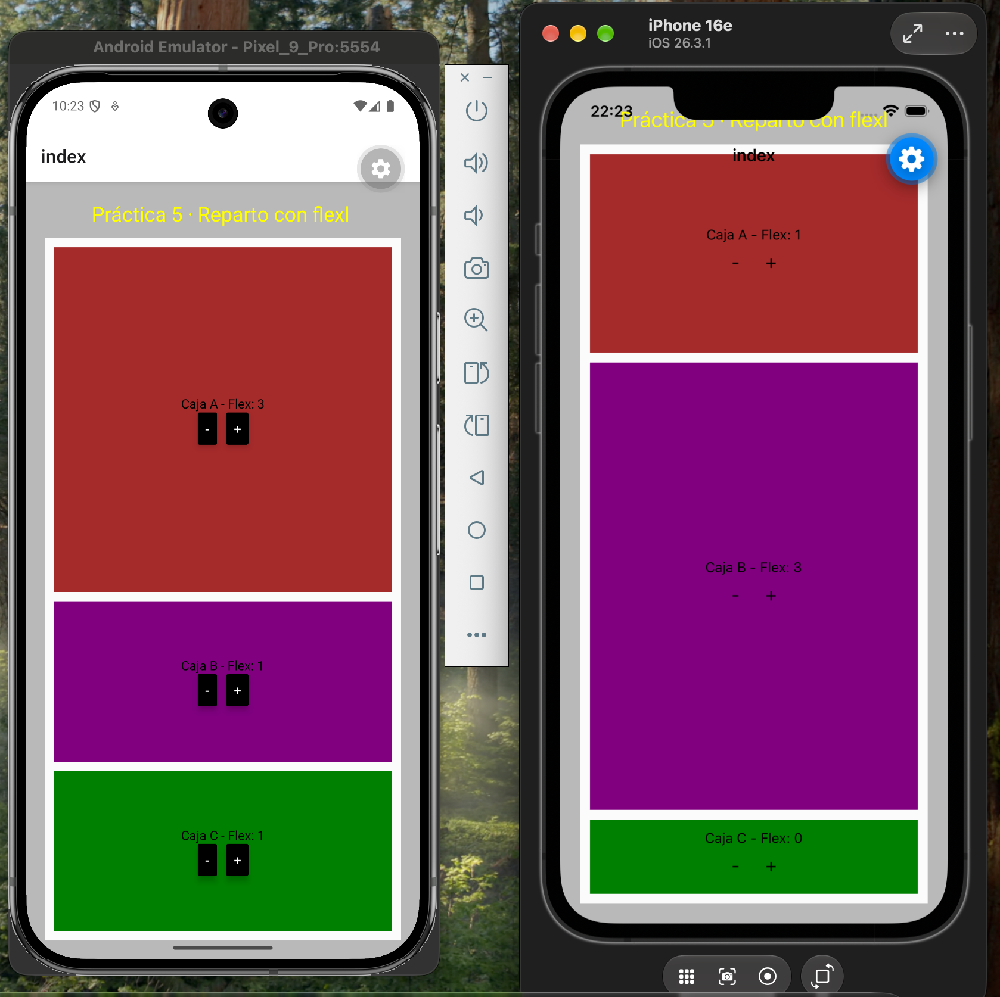
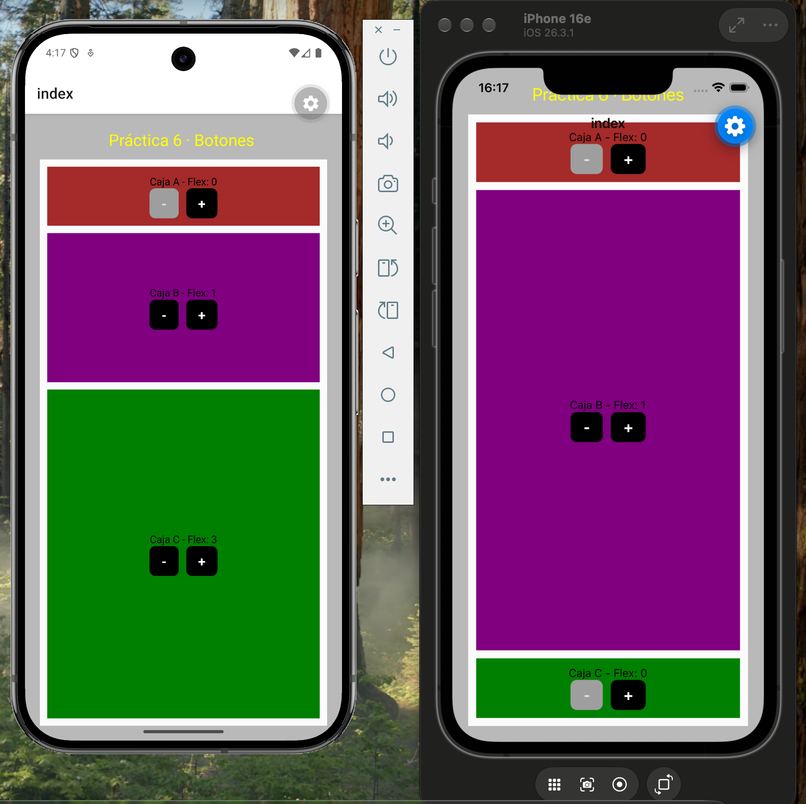
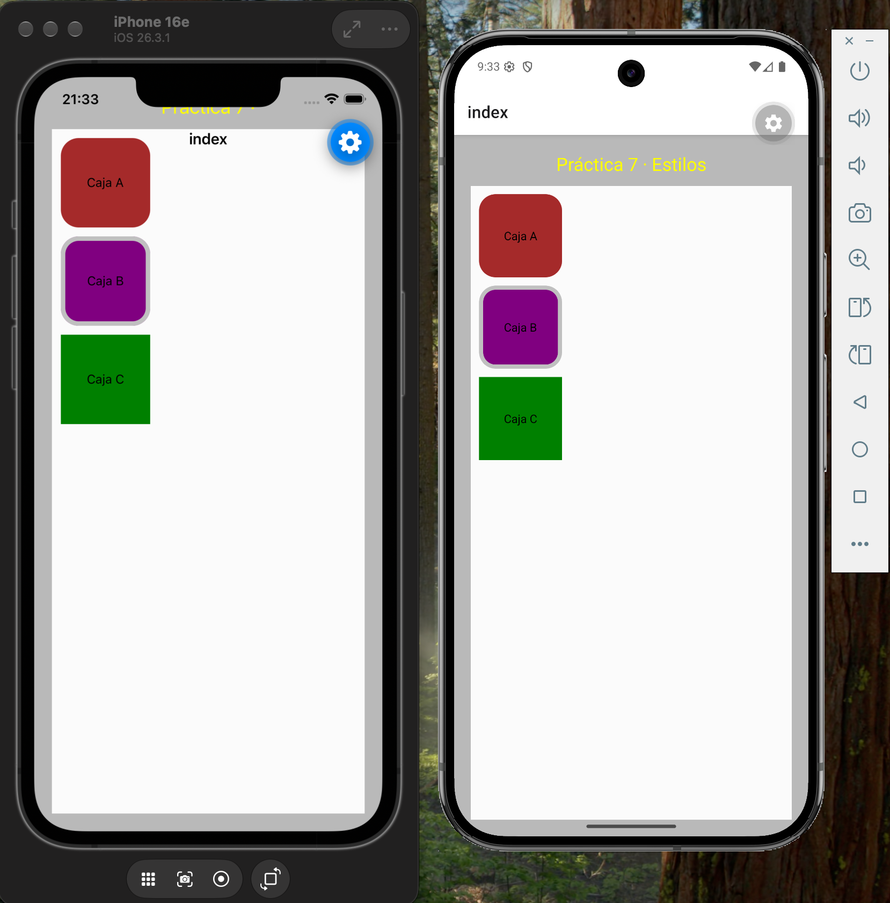
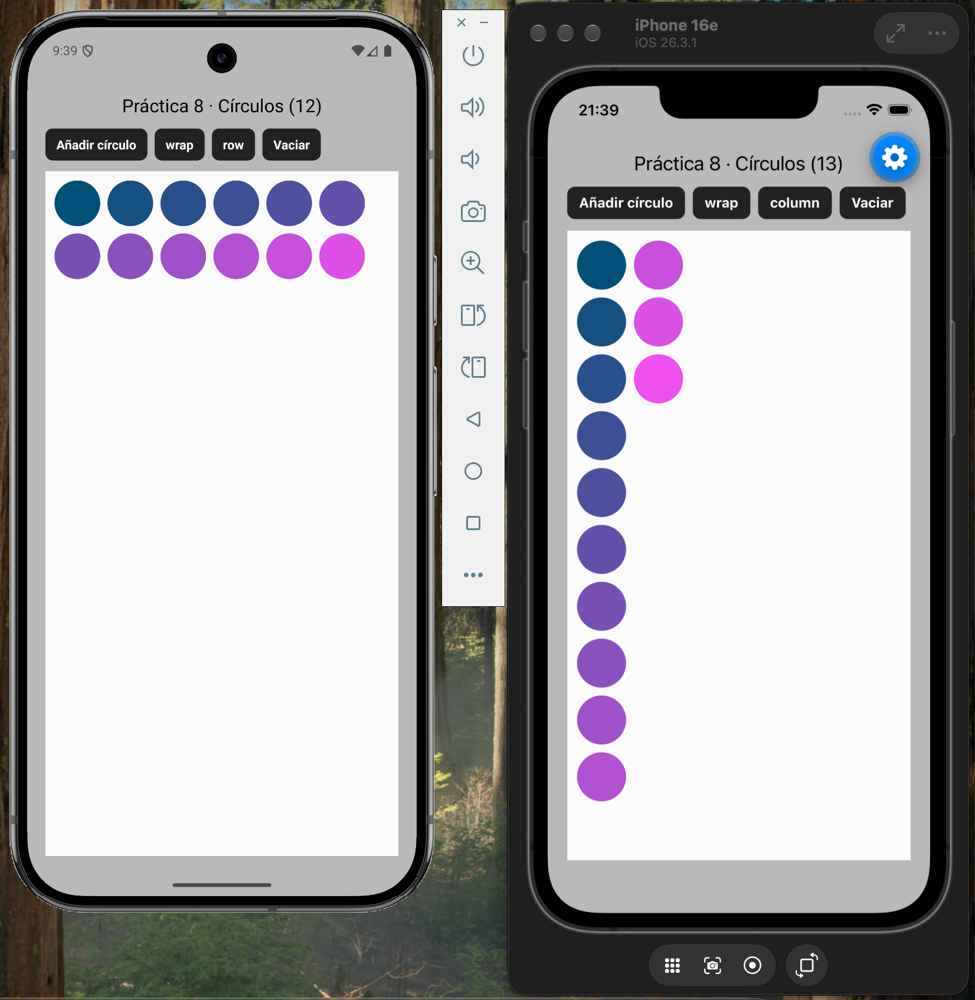

# Dossier React Native con Expo – 2.º DAM

**Alumno:** Carlos Marrero Martín
**Módulo:** Programación Multimedia y Dispositivos Móviles

## Cómo ejecutar

1. `npm install`
2. Lanzar en los emuladores (no hace falta abrirlos antes, Expo los arranca):
   - Android: `npm run android`
   - iOS: `npm run ios`
   - Los dos a la vez: `npm run emuladores`

Todas las prácticas se abren desde el índice (`src/app/index.tsx`).

## Estado de las prácticas

| Práctica | Descripción | Estado |
|---|---|---|
| 1 | Hola mundo | ✅ |
| 2 | Contador con dos botones | ✅ |
| 3 | InicioScreen y estilos separados | ✅ |
| 4 | PrincipalScreen con tres cajas | ✅ |
| 5 | Modificar flex dinámicamente | ✅ |
| 6 | Sustituir los botones por componentes táctiles | ✅ |
| 7 | Nombre y estilos personalizados | ✅ |
| 8 | Círculos dinámicos | ✅ |

---

## Práctica 1 – Hola mundo

**Procedimiento:**

1. Limpié la plantilla de Expo para dejar solo la pantalla de inicio en `src/app/index.tsx`.
2. Cambié el texto por `¡Hola mundo! Soy Carlos`, centrado con `justifyContent` y `alignItems`.
3. Moví los estilos a un `StyleSheet` (estilo `pantalla`) con fondo `lightpink`.
4. Configuré ESLint (`eslint.config.js`) y comprobé el código con `npm run lint` y `npx tsc --noEmit`.
5. Lo ejecuté en el emulador de Android y en el simulador de iOS.

**Captura:** 

**Problemas encontrados:**
Tuve problemas para abrir la app en los emuladores. Lo solucioné ajustando los scripts de `package.json`:

- `"android": "expo start --localhost --android"`
- `"ios": "expo start --localhost --ios"`
- `"emuladores": "expo start --localhost --android --ios"` (nuevo, abre los dos a la vez)

Después de este cambio la app cargó correctamente en el Pixel 9 Pro (Android) y en el iPhone 17 (iOS).

**Estado:** ✅ Terminada

## Práctica 2 – Contador con dos botones

**Procedimiento:**

1. Partí del ejemplo del contador del dossier y lo escribí en `src/app/index.tsx`, con un estado `contador` creado con `useState(0)`.
2. Muestro el valor en un `Text` (`Contador: {contador}`) con tamaño de letra 22.
3. Añadí un segundo `Button` para decrementar. Los dos usan el mismo estado:
   - **Incrementar** (`seagreen`): `setContador(n => n + 1)`
   - **Decrementar** (`crimson`): `setContador(n => n - 1)`
4. Personalicé el contenedor (estilo `caja`) con `StyleSheet.create()`:
   - Borde de 3 de grosor en color `purple` (`borderWidth`, `borderColor`).
   - Fondo lila claro `#f3e8ff` (`backgroundColor`).
   - Esquinas redondeadas con `borderRadius: 16`.
5. Coloqué los botones uno al lado del otro con `flexDirection: 'row'` y `gap: 10` (estilo `botones`), y centré la caja en la pantalla con `flex: 1`, `justifyContent` y `alignItems`.
6. Comprobé el código con `npm run lint` y `npx tsc --noEmit`.
7. Lo ejecuté en el emulador de Android y en el simulador de iOS y comprobé que el contador sube y baja al pulsar cada botón.

**Captura:** 

**Problemas encontrados:**
Ninguno. La práctica funcionó a la primera en los dos emuladores.

**Estado:** ✅ Terminada

## Práctica 3 – InicioScreen y estilos separados

**Procedimiento:**

1. Creé la carpeta `src/screens/` para guardar las pantallas fuera de `src/app/`, que queda solo para las rutas de Expo Router.
2. Guardé el «Hola mundo» de la práctica 1 en `src/screens/HolaMundoScreen.tsx` para no perderlo.
3. Moví el contador de la práctica 2 a `src/screens/InicioScreen.tsx`, con sus estilos declarados en `StyleSheet.create()` (`pantalla`, `caja`, `texto` y `botones`).
4. Dejé `src/app/index.tsx` solo importando y mostrando la pantalla:

   ```tsx
   import InicioScreen from '../screens/InicioScreen';

   export default function Index() {
     return <InicioScreen />;
   }
   ```

5. Comprobé que no había errores de importación con `npm run lint` y `npx tsc --noEmit`.
6. Lo ejecuté en el emulador de Android y en el simulador de iOS y comprobé que el contador sigue funcionando igual que en la práctica 2.

**Estructura resultante:**

```text
src/
├── app/
│   ├── _layout.tsx
│   └── index.tsx            → muestra <InicioScreen />
└── screens/
    ├── HolaMundoScreen.tsx  → práctica 1
    └── InicioScreen.tsx     → práctica 2 (contador)
```

**Captura:** el resultado visual es el mismo que en la práctica 2 ([captura P2](capturas/p02.png)), porque solo se ha reorganizado el código.

**Problemas encontrados:**
Ninguno.

**Estado:** ✅ Terminada

## Práctica 4 – PrincipalScreen con varias cajas

**Procedimiento:**

1. Creé el componente reutilizable `src/components/Caja.tsx`, que recibe dos propiedades:
   - `nombre`: el texto que se muestra dentro de la caja.
   - `bg` (opcional): el color de fondo; si no se pasa, es `green`.

   La caja mide 100 × 100 y combina el estilo base con el color recibido mediante `style={[styles.caja, { backgroundColor: bg }]}`.
2. Creé la pantalla `src/screens/PrincipalScreen.tsx` con:
   - Un `Text` con «Contenedor Principal», centrado y en amarillo.
   - Un `View` de escenario con `flex: 1`, fondo `#fbfbfb`, `padding: 10` y `gap: 10` entre las cajas.
   - Tres `Caja`: **Caja A** (`brown`), **Caja B** (`purple`) y **Caja C** (color por defecto, `green`).
3. Cambié `src/app/index.tsx` para que muestre `<PrincipalScreen />` en lugar de `<InicioScreen />`. La pantalla del contador sigue guardada en `src/screens/`.
4. Comprobé el código con `npm run lint` y `npx tsc --noEmit`.
5. Lo ejecuté en el simulador de iOS (iPhone 16e) y en el emulador de Android.

Como en React Native los contenedores van en columna por defecto (`flexDirection: 'column'`), las tres cajas aparecen una debajo de otra, pegadas a la izquierda.

**Captura:** 

**Problemas encontrados:**
En iOS la cabecera de la navegación («index») es transparente y el contenido queda por debajo: el texto «Contenedor Principal» se mete en la zona de la muesca y el título «index» se superpone al escenario. En Android se ve correctamente.

**Estado:** ✅ Terminada

## Práctica 5 – Modificar flex dinámicamente

**Procedimiento:**

1. Creé el componente `src/components/CajaFlex.tsx`, una variante de `Caja` **sin altura fija**, para que el `height: 100` no condicione el reparto de `flex`.
2. Cada `CajaFlex` tiene su propio estado `valorFlex` (`useState(0)`), así que los valores de las tres cajas son independientes. Se aplica con `style={[styles.caja, { flex: valorFlex, backgroundColor: bg }]}`.
3. Añadí dos botones a cada caja:
   - **+**: `setValorFlex(f => f + 1)`
   - **−**: `setValorFlex(f => Math.max(0, f - 1))`, para que no baje de 0.
4. Muestro el valor actual en el texto de la caja (`Caja A - Flex: 3`).
5. Creé `src/screens/FlexScreen.tsx` con el mismo escenario de la práctica 4 y las tres `CajaFlex`, y la mostré desde `src/app/index.tsx`.
6. Comprobé el código con `npm run lint` y `npx tsc --noEmit` y lo probé en Android (Pixel 9 Pro) y en iOS (iPhone 16e).

**Resultado:** el espacio libre se reparte en proporción a los valores. Por ejemplo, con A = 3, B = 1 y C = 1, la caja A ocupa 3/5 del escenario. Una caja con `flex: 0` no desaparece: se queda con el tamaño de su contenido.

**Captura:** 

**Problemas encontrados:**
Los botones `−` y `+` usan `color="black"`. En Android se ven como botones negros, pero en iOS ese color se aplica solo al texto y apenas se distinguen sobre el fondo morado (se ve en la captura). Es la diferencia del `Button` nativo entre sistemas; se solucionaría con un botón propio hecho con `Pressable`.

**Estado:** ✅ Terminada

## Práctica 6 – Sustituir los botones por componentes táctiles

**Procedimiento:**

1. Para no perder la práctica 5, creé un componente nuevo, `src/components/CajaTouch.tsx`, a partir de `CajaFlex`. `CajaFlex.tsx` no se ha modificado.
2. Sustituí los `Button` nativos por componentes táctiles, que no tienen aspecto propio y envuelven un `Text` con mi propio estilo:
   - **+** con `TouchableHighlight`: muestra una alerta con `Alert.alert()` y aumenta el valor con `setValorFlex(f => f + 1)`. Al pulsarlo aparece un fondo gris oscuro (`underlayColor="#555"`).
   - **−** con `TouchableOpacity`: reduce el valor con `setValorFlex(f => Math.max(0, f - 1))`. Al pulsarlo se vuelve semitransparente.
3. Personalicé los dos botones con `StyleSheet.create()` (estilo `boton`): fondo negro, `borderRadius: 8`, `padding` y texto blanco en negrita de tamaño 18.
4. Desactivé el botón **−** cuando el valor es 0 con `disabled={valorFlex === 0}`. Como `disabled` no cambia el aspecto del botón, añadí un estilo condicional que lo pone en gris:

   ```tsx
   style={[styles.boton, desactivado && styles.botonDesactivado]}
   ```

   Si `desactivado` es `false`, React Native ignora ese valor dentro del array de estilos.
5. Creé `src/screens/TouchScreen.tsx` con el mismo escenario de la práctica 5 y las tres `CajaTouch`, y la mostré desde `src/app/index.tsx`.
6. Comprobé el código con `npm run lint` y `npx tsc --noEmit` y lo probé en Android (Pixel 9 Pro) y en iOS (iPhone 16e).

**Resultado:** los botones se ven igual en Android y en iOS, porque su aspecto lo define mi estilo y no el sistema operativo. Esto resuelve el problema de la práctica 5, donde el `Button` nativo se veía distinto en cada sistema.

**Captura:** 

**Problemas encontrados:**

- `Alert.alert()` no detiene la ejecución: la alerta aparece y el valor se actualiza a la vez. Además, dentro del `onPress` la variable `valorFlex` todavía tiene el valor anterior, porque `setValorFlex` no la cambia al momento sino en el siguiente render. Por eso el mensaje de la alerta muestra `valorFlex + 1`.
- Con un `underlayColor` claro (`#ddd`), el texto blanco del botón casi no se veía al pulsarlo. Lo cambié por un gris oscuro (`#555`).

**Estado:** ✅ Terminada

## Práctica 7 – Nombre y estilos personalizados

**Procedimiento:**

1. Amplié el componente `src/components/Caja.tsx` con una nueva propiedad **opcional** `style`, del tipo `StyleProp<ViewStyle>`:

   ```tsx
   import type { StyleProp, ViewStyle } from 'react-native';

   type Props = {
     nombre: string;
     bg?: string;
     style?: StyleProp<ViewStyle>;
   };
   ```

   - `ViewStyle` limita la propiedad a estilos válidos para un `View` (por ejemplo, TypeScript no permite `fontSize`).
   - `StyleProp` permite recibir cualquier cosa que acepte la prop `style`: un objeto, un estilo de `StyleSheet` o un array de estilos.
   - Al ser opcional (`?`), la práctica 4 sigue funcionando sin cambios: allí no se pasa `style` y la caja se ve igual que antes.
2. Añadí el estilo recibido **al final** del array de estilos de la caja:

   ```tsx
   <View style={[styles.caja, { backgroundColor: bg }, style]}>
   ```

   React Native fusiona los estilos de izquierda a derecha y, si dos tienen la misma propiedad, gana el último. Así, quien usa la caja puede añadir estilos nuevos o sobrescribir los del componente. Cuando no se pasa `style`, vale `undefined` y se ignora.
3. Creé la pantalla `src/screens/EstilosScreen.tsx`, a partir de `PrincipalScreen`, con tres cajas que muestran su nombre:
   - **Caja A** (`brown`): sin `style`, para comprobar que la propiedad es opcional.
   - **Caja B** (`purple`): con esquinas redondeadas y un borde distinto: `style={{ borderRadius: 20, borderWidth: 7, borderColor: 'gold' }}`.
   - **Caja C** (color por defecto): con `style={{ width: 150 }}`, que sobrescribe el `width: 100` del estilo base porque va después en el array.
4. Mostré la pantalla desde `src/app/index.tsx` y comprobé que `PrincipalScreen` (práctica 4) se sigue viendo igual que antes.
5. Comprobé el código con `npm run lint` y `npx tsc --noEmit` y lo probé en Android (Pixel 9 Pro) y en iOS (iPhone 16e).

**Captura:** 

**Observación sobre el color:**
Al añadir `style` hay dos formas de dar color a la caja: la propiedad `bg` y un `backgroundColor` dentro de `style`. Si se usan las dos a la vez, gana el de `style`, porque va el último en el array. Lo dejé así a propósito:

- `bg` es un atajo cómodo para el caso habitual y `style` permite sobrescribir cualquier propiedad, incluido el color. Es el comportamiento habitual en los componentes de React Native.
- Poner `bg` al final no funcionaría bien: como tiene valor por defecto (`green`), siempre taparía el `backgroundColor` de `style`.
- Eliminar `bg` obligaría a modificar la práctica 4.

**Problemas encontrados:**
Ninguno.

**Estado:** ✅ Terminada

## Práctica 8 – Círculos dinámicos

**Procedimiento:**

1. Creé el componente reutilizable `src/components/BotonControl.tsx`: un `TouchableOpacity` con un `Text` que recibe por props el título (`titulo`) y la función a ejecutar (`onPress: () => void`). Todos los controles de la pantalla lo usan.
2. Creé `src/screens/CirculosScreen.tsx` con tres estados:
   - `colores` (`useState<string[]>([])`): los colores de los círculos. El escenario empieza vacío.
   - `enFila`: alterna entre `flexDirection: 'row'` y `'column'`.
   - `conWrap`: alterna entre `flexWrap: 'wrap'` y `'nowrap'`.
3. El botón **Añadir círculo** calcula un color a partir del número de círculos y lo añade al array creando uno nuevo: `setColores(actual => [...actual, color])`. Los valores RGB se limitan con `Math.min(255, valor)` para que no superen 255.
4. Los círculos se pintan con `colores.map(...)`: cada uno es un `View` de 50 × 50 con `borderRadius: 25`, y usa el índice como `key`, ya que solo se añaden al final.
5. Los botones **wrap/nowrap** y **row/column** invierten su estado con `setValor(v => !v)` y muestran el modo activo. El escenario aplica `flexDirection` y `flexWrap` con un operador ternario.
6. Añadí un botón **Vaciar** para reiniciar el escenario durante las pruebas.
7. Comprobé el código con `npm run lint` y `npx tsc --noEmit` y lo probé en Android (Pixel 9 Pro) y en iOS (iPhone 16e).

**Resultado:** con `nowrap`, los círculos se colocan en una sola línea aunque no quepan y se salen del escenario. Con `wrap`, al llegar al borde pasan a la fila (o columna) siguiente.

**Captura:** 

**Problemas encontrados:**
En el simulador de iOS (iPhone 16e, iOS 26) **ningún botón respondía**, aunque se veían bien. El código de los botones era correcto: el problema era la cabecera de navegación.

- `src/app/_layout.tsx` usaba `<Stack />` sin opciones, así que Expo Router añade una cabecera nativa con el nombre de la ruta («index»).
- En iOS 26 esa cabecera es transparente (efecto «cristal líquido») y la pantalla se dibuja por debajo de ella. Es el mismo problema que vi en la práctica 4, donde «index» se superponía al contenido.
- Aunque no se vea, la cabecera es una capa nativa que está **por encima** del contenido y recibe los toques. Como los botones estaban justo en esa franja superior, los toques nunca les llegaban.

**Solución:**

1. Oculté la cabecera nativa en `src/app/_layout.tsx`:

   ```tsx
   return <Stack screenOptions={{ headerShown: false }} />;
   ```

2. Al quitar la cabecera, el contenido empieza en el borde superior de la pantalla y quedaría debajo de la muesca y de la barra de estado. Para evitarlo, cambié el `View` raíz de `CirculosScreen` por un `SafeAreaView` de `react-native-safe-area-context`, que añade el margen necesario en cada dispositivo:

   ```tsx
   import { SafeAreaView } from 'react-native-safe-area-context';

   <SafeAreaView style={styles.pantalla}>
     ...
   </SafeAreaView>
   ```

Después de estos cambios, los botones funcionan en iOS y el título ya no se mezcla con «index».

**Estado:** ✅ Terminada
