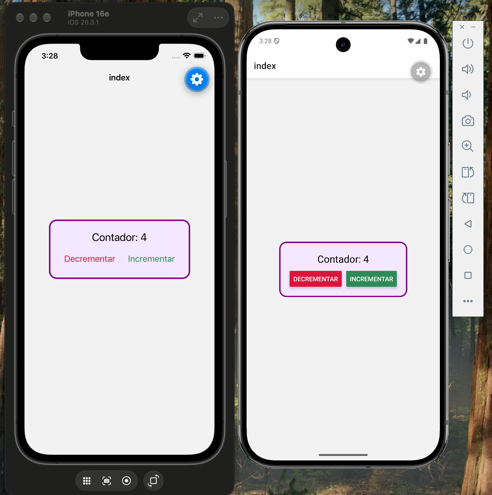

# Dossier React Native con Expo – 2.º DAM

**Alumno:** Carlos Marrero Martín
**Módulo:** Programación Multimedia y Dispositivos Móviles

## Cómo ejecutar

1. `npm install`
2. Lanzar en los emuladores (no hace falta abrirlos antes, Expo los arranca):
   - Android: `npm run android`
   - iOS: `npm run ios`
   - Los dos a la vez: `npm run emuladores`

Todas las prácticas se abren desde el índice (`src/app/index.tsx`).

## Estado de las prácticas

| Práctica | Descripción | Estado |
|---|---|---|
| 1 | Hola mundo | ✅ |
| 2 | Contador con dos botones | ✅ |
| 3 | InicioScreen y estilos separados | ✅ |
| 4 | PrincipalScreen con tres cajas | ✅ |

---

## Práctica 1 – Hola mundo

**Procedimiento:**

1. Limpié la plantilla de Expo para dejar solo la pantalla de inicio en `src/app/index.tsx`.
2. Cambié el texto por `¡Hola mundo! Soy Carlos`, centrado con `justifyContent` y `alignItems`.
3. Moví los estilos a un `StyleSheet` (estilo `pantalla`) con fondo `lightpink`.
4. Configuré ESLint (`eslint.config.js`) y comprobé el código con `npm run lint` y `npx tsc --noEmit`.
5. Lo ejecuté en el emulador de Android y en el simulador de iOS.

**Captura:** 

**Problemas encontrados:**
Tuve problemas para abrir la app en los emuladores. Lo solucioné ajustando los scripts de `package.json`:

- `"android": "expo start --localhost --android"`
- `"ios": "expo start --localhost --ios"`
- `"emuladores": "expo start --localhost --android --ios"` (nuevo, abre los dos a la vez)

Después de este cambio la app cargó correctamente en el Pixel 9 Pro (Android) y en el iPhone 17 (iOS).

**Estado:** ✅ Terminada

## Práctica 2 – Contador con dos botones

**Procedimiento:**

1. Partí del ejemplo del contador del dossier y lo escribí en `src/app/index.tsx`, con un estado `contador` creado con `useState(0)`.
2. Muestro el valor en un `Text` (`Contador: {contador}`) con tamaño de letra 22.
3. Añadí un segundo `Button` para decrementar. Los dos usan el mismo estado:
   - **Incrementar** (`seagreen`): `setContador(n => n + 1)`
   - **Decrementar** (`crimson`): `setContador(n => n - 1)`
4. Personalicé el contenedor (estilo `caja`) con `StyleSheet.create()`:
   - Borde de 3 de grosor en color `purple` (`borderWidth`, `borderColor`).
   - Fondo lila claro `#f3e8ff` (`backgroundColor`).
   - Esquinas redondeadas con `borderRadius: 16`.
5. Coloqué los botones uno al lado del otro con `flexDirection: 'row'` y `gap: 10` (estilo `botones`), y centré la caja en la pantalla con `flex: 1`, `justifyContent` y `alignItems`.
6. Comprobé el código con `npm run lint` y `npx tsc --noEmit`.
7. Lo ejecuté en el emulador de Android y en el simulador de iOS y comprobé que el contador sube y baja al pulsar cada botón.

**Captura:** 

**Problemas encontrados:**
Ninguno. La práctica funcionó a la primera en los dos emuladores.

**Estado:** ✅ Terminada

## Práctica 3 – InicioScreen y estilos separados

**Procedimiento:**

1. Creé la carpeta `src/screens/` para guardar las pantallas fuera de `src/app/`, que queda solo para las rutas de Expo Router.
2. Guardé el «Hola mundo» de la práctica 1 en `src/screens/HolaMundoScreen.tsx` para no perderlo.
3. Moví el contador de la práctica 2 a `src/screens/InicioScreen.tsx`, con sus estilos declarados en `StyleSheet.create()` (`pantalla`, `caja`, `texto` y `botones`).
4. Dejé `src/app/index.tsx` solo importando y mostrando la pantalla:

   ```tsx
   import InicioScreen from '../screens/InicioScreen';

   export default function Index() {
     return <InicioScreen />;
   }
   ```

5. Comprobé que no había errores de importación con `npm run lint` y `npx tsc --noEmit`.
6. Lo ejecuté en el emulador de Android y en el simulador de iOS y comprobé que el contador sigue funcionando igual que en la práctica 2.

**Estructura resultante:**

```text
src/
├── app/
│   ├── _layout.tsx
│   └── index.tsx            → muestra <InicioScreen />
└── screens/
    ├── HolaMundoScreen.tsx  → práctica 1
    └── InicioScreen.tsx     → práctica 2 (contador)
```

**Captura:** el resultado visual es el mismo que en la práctica 2 ([captura P2](capturas/p02.png)), porque solo se ha reorganizado el código.

**Problemas encontrados:**
Ninguno.

**Estado:** ✅ Terminada

## Práctica 4 – PrincipalScreen con varias cajas

**Procedimiento:**

1. Creé el componente reutilizable `src/components/Caja.tsx`, que recibe dos propiedades:
   - `nombre`: el texto que se muestra dentro de la caja.
   - `bg` (opcional): el color de fondo; si no se pasa, es `green`.

   La caja mide 100 × 100 y combina el estilo base con el color recibido mediante `style={[styles.caja, { backgroundColor: bg }]}`.
2. Creé la pantalla `src/screens/PrincipalScreen.tsx` con:
   - Un `Text` con «Contenedor Principal», centrado y en amarillo.
   - Un `View` de escenario con `flex: 1`, fondo `#fbfbfb`, `padding: 10` y `gap: 10` entre las cajas.
   - Tres `Caja`: **Caja A** (`brown`), **Caja B** (`purple`) y **Caja C** (color por defecto, `green`).
3. Cambié `src/app/index.tsx` para que muestre `<PrincipalScreen />` en lugar de `<InicioScreen />`. La pantalla del contador sigue guardada en `src/screens/`.
4. Comprobé el código con `npm run lint` y `npx tsc --noEmit`.
5. Lo ejecuté en el simulador de iOS (iPhone 16e) y en el emulador de Android.

Como en React Native los contenedores van en columna por defecto (`flexDirection: 'column'`), las tres cajas aparecen una debajo de otra, pegadas a la izquierda.

**Captura:** 

**Problemas encontrados:**
En iOS la cabecera de la navegación («index») es transparente y el contenido queda por debajo: el texto «Contenedor Principal» se mete en la zona de la muesca y el título «index» se superpone al escenario. En Android se ve correctamente.

**Estado:** ✅ Terminada
