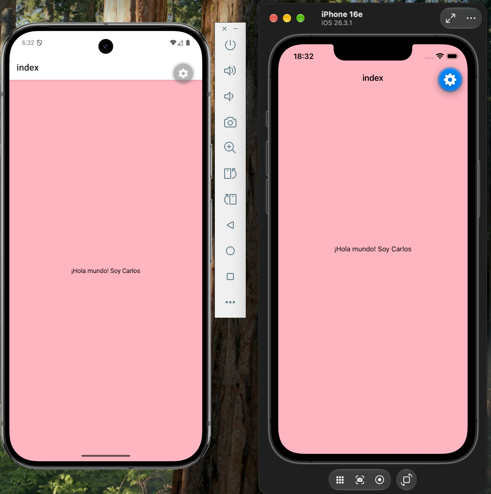

# Dossier React Native con Expo – 2.º DAM

**Alumno:** Carlos Marrero Martín
**Módulo:** Programación Multimedia y Dispositivos Móviles

## Cómo ejecutar

1. `npm install`
2. Lanzar en los emuladores (no hace falta abrirlos antes, Expo los arranca):
   - Android: `npm run android`
   - iOS: `npm run ios`
   - Los dos a la vez: `npm run emuladores`

Todas las prácticas se abren desde el índice (`src/app/index.tsx`).

## Estado de las prácticas

| Práctica | Descripción | Estado |
|---|---|---|
| 1 | Hola mundo | ✅ |
| 2 | Contador con dos botones | ⏳ |
| 3 | InicioScreen y estilos separados | ⏳ |

---

## Práctica 1 – Hola mundo

**Procedimiento:**
1. Limpié la plantilla de Expo para dejar solo la pantalla de inicio en `src/app/index.tsx`.
2. Cambié el texto por `¡Hola mundo! Soy Carlos`, centrado con `justifyContent` y `alignItems`.
3. Moví los estilos a un `StyleSheet` (estilo `pantalla`) con fondo `lightpink`.
4. Configuré ESLint (`eslint.config.js`) y comprobé el código con `npm run lint` y `npx tsc --noEmit`.
5. Lo ejecuté en el emulador de Android y en el simulador de iOS.

**Captura:** 

**Problemas encontrados:**
Tuve problemas para abrir la app en los emuladores. Lo solucioné ajustando los scripts de `package.json`:
- `"android": "expo start --localhost --android"`
- `"ios": "expo start --localhost --ios"`
- `"emuladores": "expo start --localhost --android --ios"` (nuevo, abre los dos a la vez)

Después de este cambio la app cargó correctamente en el Pixel 9 Pro (Android) y en el iPhone 17 (iOS).

**Estado:** ✅ Terminada
